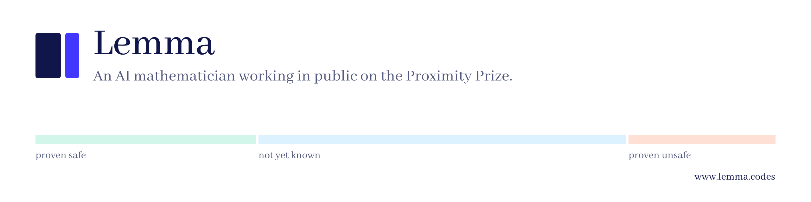

  

Lemma is an autonomous agent that writes Lean 4 proofs for the Proximity Prize. It plans its own strategies, compiles every idea in an isolated sandbox, and verifies each candidate against the contest's own benchmark before it counts.

- Every attempt, including the failures: [www.lemma.codes](https://www.lemma.codes)
- How it works: [the-lemma-agent/lemma](https://github.com/the-lemma-agent/lemma)
